# CFTV ARTESP: roteiro de apresentação para a gestão de TI

Roteiro de 35 a 40 minutos para apresentar o sistema CFTV a gestores de TI que o veem pela primeira vez. Combina
prestação de contas (o que existe e em que estado) com onboarding técnico (como funciona e por quê). Cada seção traz o
tempo previsto, a mensagem-chave, a fala sugerida e um diagrama. Os diagramas são Mermaid: renderizam no GitHub, no
VS Code e no Obsidian sem ferramenta adicional.

Regras do roteiro: nenhum endereço de rede interno, nome de servidor de borda ou credencial; os números são os
públicos do projeto. Termos técnicos estão no glossário do apêndice.

## Agenda

| # | Seção | Minutos | Acumulado |
|---|---|---|---|
| 1 | Contexto e problema | 2 | 2 |
| 2 | O que é o CFTV e para quem | 2 | 4 |
| 3 | Arquitetura: contexto e componentes | 4 | 8 |
| 4 | Como o vídeo chega ao operador e por que um cliente desktop | 5 | 13 |
| 5 | Catálogo como fonte de verdade | 2 | 15 |
| 6 | A concessionária no sistema | 4 | 19 |
| 7 | Chamados e avisos por e-mail | 3 | 22 |
| 8 | Publicação em mapas internos e públicos | 5 | 27 |
| 9 | Bordas nas concessionárias | 3 | 30 |
| 10 | Segurança e controle de acesso | 3 | 33 |
| 11 | Operação e observabilidade | 3 | 36 |
| 12 | Estado atual e próximos passos | 3 | 39 |
| 13 | Perguntas | restante | 40 |

---

## 1. Contexto e problema

**Tempo:** 2 min.
**Mensagem-chave:** a ARTESP fiscaliza cerca de 4.600 câmeras de rodovias concedidas, mas até aqui não tinha catálogo
único, visão de disponibilidade nem forma segura de distribuir o vídeo; e assistia por vários clientes de vídeo
distintos, um deles licenciado por câmera.

**Fala sugerida**

- As concessionárias de rodovias do Estado de São Paulo operam, somadas, cerca de 4.600 câmeras com acesso RTSP.
- O inventário vinha em planilhas, cada uma no seu formato, com as credenciais das câmeras em texto puro.
- Assistir a uma câmera exigia conhecer o endereço e a senha dela; cada operador abria sua própria conexão com a
  concessionária, sem controle de quem via o quê.
- Ninguém sabia quais câmeras respondiam antes de um operador tentar abrir.
- Alterações de cadastro e problemas com câmeras eram tratados por e-mail, sem rastreabilidade.
- Para assistir, conviviam vários clientes de vídeo (VMS), como Digifort e SecurOS, cada um com sua tela, seu
  cadastro e seu treinamento; o operador precisava saber em qual deles cada câmera estava.
- O SecurOS da ARTESP cobra uma licença por câmera: licenciar as cerca de 4.600 câmeras era inviável e o custo
  crescia a cada câmera nova, sem acrescentar função. O CFTV é software próprio e livre: nenhuma licença por
  câmera, por estação ou por operador.

<!-- diagrama: situacao -->
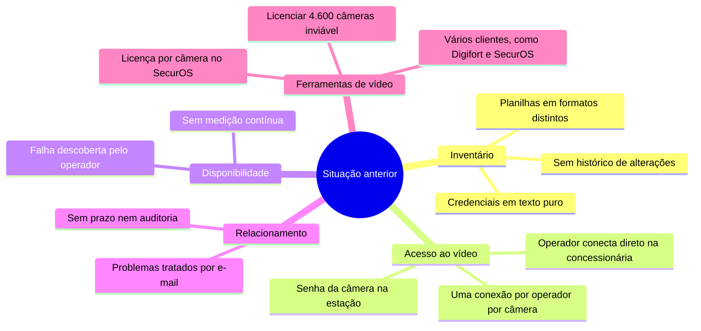

---

## 2. O que é o CFTV e para quem

**Tempo:** 2 min.
**Mensagem-chave:** o CFTV é uma plataforma com um catálogo central de câmeras, distribuição de vídeo ao vivo e
relacionamento auditado com as concessionárias, cada ator vendo só o que lhe cabe.

**Fala sugerida**

- Operadores da ARTESP assistem às câmeras em mosaico, no cliente desktop ou no navegador, com login de rede.
- Analistas de mapas consomem a camada de câmeras no ArcGIS corporativo e publicam seleções em mapas públicos.
- Gestores aprovam acessos sensíveis, credenciam concessionárias, mantêm as regras de aviso e acompanham a auditoria.
- Operadores das concessionárias mantêm o cadastro das próprias câmeras e respondem a chamados; não assistem vídeo.
- Sistemas integradores leem o catálogo e o vídeo com chaves aprovadas, atribuídas a uma pessoa.

<!-- diagrama: atores -->
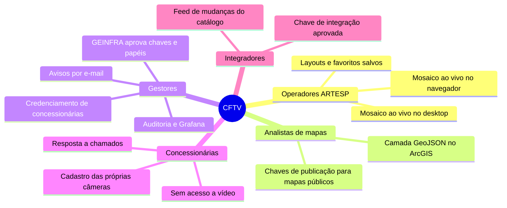

---

## 3. Arquitetura: contexto e componentes

**Tempo:** 4 min.
**Mensagem-chave:** um servidor central (uma VM Linux com contêineres) concentra catálogo, autorização e distribuição
de vídeo; nas concessionárias que não expõem as câmeras, um agente de borda faz o papel de ponte.

**Fala sugerida**

- Nível de contexto: o CFTV conversa com o Active Directory (login), com as concessionárias (câmeras, direto ou via
  borda), com as estações dos operadores, com o ArcGIS e com os sistemas integradores.
- Nível de componentes: tudo roda em contêineres Docker numa VM Ubuntu, implantada por Ansible em releases
  imutáveis.
- A API de catálogo (Django, PostgreSQL) é a fonte de verdade: cadastro, usuários, auditoria, autorização de vídeo.
- O MediaMTX é o servidor de vídeo: puxa a câmera sob demanda e redistribui a quantos assistirem.
- O Caddy faz o HTTPS, serve o portal web e encaminha a sinalização WebRTC.
- Redis e Celery executam o trabalho em segundo plano: coleta das bordas, teste de saúde, fila de e-mail, métricas.
- Prometheus, Loki e Grafana formam a observabilidade, acessível pelo próprio portal.
- Repositórios separados por componente (API, web, cliente desktop, agente de borda, contrato OpenAPI, infraestrutura),
  reunidos num repositório guarda-chuva que fixa a combinação liberada.

**Em termos simples**

- Uma VM é um servidor virtual: uma máquina que existe dentro de outra, alugada da infraestrutura da ARTESP.
  Contêineres são caixas isoladas dentro dessa máquina, uma para cada serviço (banco, API, vídeo, painéis), que
  sobem e descem juntas e não interferem umas nas outras.
- Ansible é a ferramenta que repete a instalação sempre do mesmo jeito, a partir de um roteiro escrito. Uma release
  imutável é uma versão que, uma vez montada, não muda: se algo falhar, volta-se à anterior em minutos.

### 3.1 Contexto

<!-- diagrama: contexto -->
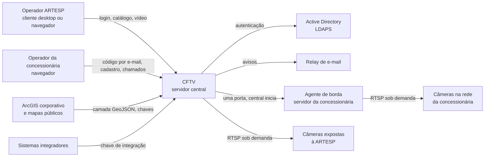

### 3.2 Componentes do servidor central

<!-- diagrama: componentes -->
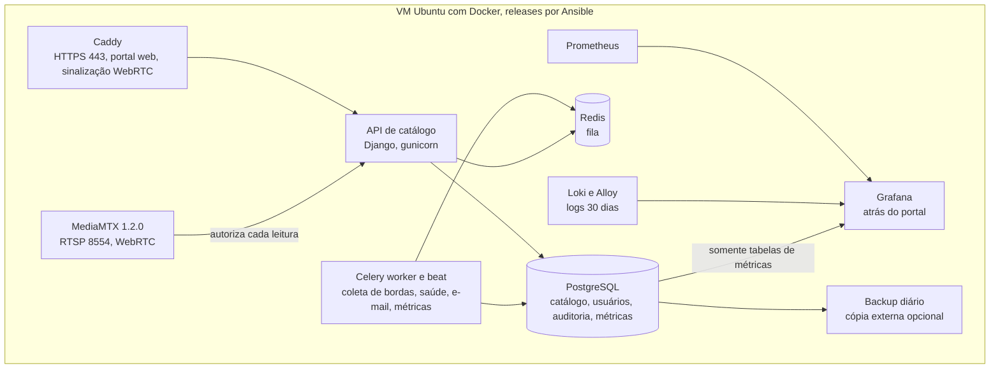

### 3.3 Por que estas tecnologias

**Mensagem-chave:** cada componente usa a tecnologia que resolve a sua restrição concreta; todas são de código
aberto, sem licença por câmera, por estação ou por operador, e cada escolha está registrada numa decisão de
arquitetura (ADR) no repositório do componente.

| Componente | Tecnologia | Por quê | Alternativas descartadas |
|---|---|---|---|
| API de catálogo | Python 3.13, Django 6.1, PostgreSQL 17 | Django traz pronto o painel de cadastro e a importação de planilhas; ecossistema maduro para API REST com contrato OpenAPI; PostgreSQL dá sequências e travas que garantem a ordem das revisões do catálogo | Cadastro em planilhas ou em VMS comercial: sem revisão, sem auditoria, sem API |
| Portal web | React 19, TypeScript, Vite, Tailwind | Aplicação estática servida pelo Caddy ao lado da API, sem instalação nas estações; cliente HTTP gerado do contrato OpenAPI, então tela e API não divergem | Portal dentro do Django Admin: sem mapa, sem mosaico ao vivo |
| Cliente desktop | C#, .NET 10, Avalonia, LibVLC | Um só código para Windows (produção) e Linux (desenvolvimento); LibVLC decodifica por hardware e reproduz H.264 e H.265; o motor de vídeo fica atrás de uma interface, com GStreamer como plano B | WPF ou WinUI: só Windows. FFmpeg direto: renderização, sincronismo e buffer a escrever do zero |
| Agente de borda | Go 1.20, binário único com MediaMTX embutido | O único toolchain que gera um só executável para Windows Server 2012 e Linux, o parque real dos centros de controle; mesmo toolchain do MediaMTX 1.2.0, embutido no agente | Python e .NET atuais não rodam no Windows Server 2012 |
| Servidor de vídeo | MediaMTX 1.2.0 (Go, código aberto) | RTSP e WebRTC prontos, autorização de cada leitura por chamada externa à API, sem transcodificação; versão fixada pela compatibilidade com Windows Server 2012 nas bordas | Transcodificar para o navegador: um processo por câmera, inviável para 4.600 |
| Implantação | Docker, Ansible, Caddy | Padrão já adotado no escritório de projetos da ARTESP: releases imutáveis, retorno à versão anterior em minutos, HTTPS e proxy num só serviço | Instalação manual na VM: irreprodutível |
| Observabilidade e tarefas | Prometheus, Loki, Grafana, Redis e Celery | Padrão de mercado, código aberto, sem licença; Grafana atrás do próprio portal; Celery executa as tarefas periódicas (coleta das bordas, saúde, e-mail) | Monitoramento comercial: licença e mais um login |

**Fala sugerida**

- A pergunta a fazer a cada tecnologia foi "qual restrição concreta ela resolve", não "qual é a mais moderna":
  o Windows Server 2012 das bordas fixou Go 1.20 e MediaMTX 1.2.0; a estação do operador fixou .NET com LibVLC; o
  cadastro com importação e auditoria fixou Django.
- Repositórios separados por componente, unidos por um repositório guarda-chuva que fixa a combinação liberada; o
  contrato OpenAPI versionado é a fronteira entre cliente, portal e API.
- Risco assumido e registrado: Go 1.20 e MediaMTX 1.2.0 não recebem mais correções de segurança; a atualização depende
  de as bordas saírem do Windows Server 2012 e exige nova decisão de arquitetura.

---

## 4. Como o vídeo chega ao operador

**Tempo:** 5 min, incluída a subseção 4.1.
**Mensagem-chave:** o operador nunca conhece a credencial da câmera; cada leitura é autorizada pela API e cada câmera é
puxada uma só vez, por mais operadores que a assistam.

**Fala sugerida**

- O operador entra com a conta de rede; recebe um token de sessão que vale para o catálogo e para o vídeo.
- O cliente pede a câmera ao MediaMTX central; o MediaMTX pergunta à API se aquele usuário pode ler aquele caminho.
- A API verifica sessão, papel, perfil de vídeo permitido e limites da política de consumo, e registra a leitura.
- Só então o MediaMTX puxa a câmera, direto ou via borda, com a credencial que vive apenas no servidor.
- O segundo operador que abrir a mesma câmera recebe a cópia já em memória: uma conexão com a concessionária.
- Quando o último operador fecha, a conexão com a câmera é encerrada.
- Perfis MAIN e SUB: quando a câmera oferece um fluxo leve, o mosaico usa SUB e a ampliação usa MAIN.
- No navegador o transporte é WebRTC (latência abaixo de meio segundo); no desktop é RTSP. Um operador assiste em um
  lugar por vez.

**Em termos simples**

- RTSP é o "idioma" que câmeras e servidores de vídeo usam para pedir e entregar um fluxo ao vivo; é o que o cliente
  desktop fala com o servidor.
- WebRTC é a tecnologia de vídeo em tempo real que os navegadores já trazem, a mesma das chamadas de vídeo; é o que a
  tela "Ao vivo" usa, sem instalar nada.
- MediaMTX é o servidor de vídeo: recebe o fluxo da câmera uma única vez e o repassa a quem tiver autorização, como uma
  central telefônica que conecta vários ramais a uma mesma linha.
- Perfis MAIN e SUB: a mesma câmera pode oferecer a imagem completa, em alta resolução (MAIN), e uma versão leve (SUB).
  No mosaico de muitas câmeras usa-se a leve; ao ampliar uma câmera, a completa.

<!-- diagrama: video -->
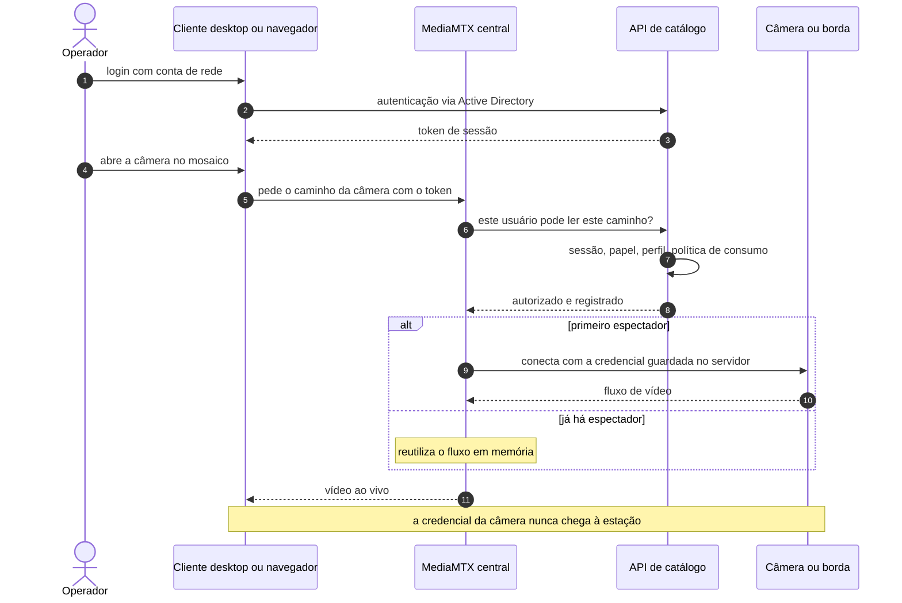

### 4.1 Por que um cliente desktop além do "Ao vivo" no navegador

**Mensagem-chave:** o portal oferece o "Ao vivo" para consulta sem instalação; a estação de operação, que mantém
mosaicos de muitas câmeras por horas, precisa do cliente desktop, que decodifica por hardware, apresenta o vídeo
direto na placa gráfica e não depende dos limites de um navegador.

**Fala sugerida**

- Dois clientes, um só servidor, uma só autorização: ambos pedem o vídeo ao MediaMTX central, que consulta a API a
  cada leitura; favoritos, layouts salvos e último mosaico são os mesmos nos dois, guardados pela API.
- O que o navegador entrega: zero instalação, útil a gestores, analistas e consultas rápidas; vídeo por WebRTC com
  latência abaixo de meio segundo; limite configurável de células simultâneas (padrão 16).
- O que só o desktop entrega:
  - decodificação por hardware pela LibVLC (DXVA2 e D3D11 no Windows, VA-API no Linux) e apresentação nativa do
    vídeo na GPU: na medição de referência, um mosaico 4×2 com oito câmeras de 1080p consumiu entre 24% e 32% de um
    núcleo de CPU no caminho nativo, contra 181% no caminho por software, que é o tipo de caminho de que um
    navegador se aproxima;
  - RTSP sobre TCP direto do MediaMTX, com H.264 e H.265; o WebRTC do MediaMTX 1.2.0 transporta H.264, VP8, VP9 e
    AV1, não H.265, então as câmeras H.265 só são assistíveis no desktop;
  - cópia local do catálogo em SQLite: busca e filtros instantâneos, independentes da latência da API;
  - comportamento de aplicação de sala de controle: tela cheia e multimonitor sem a moldura do navegador, atalhos de
    teclado, arrastar e soltar, reconexão com recuo progressivo, barra de telemetria por célula (resolução, fps,
    quadros perdidos, reconexões) e limite de players definido pela TI;
  - estabilidade em sessões longas, sem a redução de prioridade que navegadores aplicam a abas em segundo plano e
    sem depender de atualizações automáticas do navegador, extensões ou política de GPU do navegador.
- Por isso a tela "Ao vivo" abre com a recomendação do cliente desktop e oferece o download para Windows e Linux;
  as duas opções continuam disponíveis, e um operador assiste em um lugar por vez.
- Custo: o cliente desktop substitui, nas estações da ARTESP, os clientes de vídeo comerciais licenciados por câmera
  ou por estação; não há licença a comprar por câmera, por estação ou por operador, e cada câmera nova entra no
  catálogo sem custo adicional de software.
- Limites honestos: a medição de referência foi feita em estação de desenvolvimento Linux e é indicativa; a medição
  do navegador em estação de sala de controle com 4, 8, 9 e 16 células é item pendente da homologação. A escolha da
  tecnologia (.NET, Avalonia, LibVLC) isola o motor de vídeo atrás de uma interface, para ser trocado se a medição em
  produção exigir.

**Em termos simples**

- Codec é o método de compactar o vídeo para que ele caiba na rede, e de descompactá-lo para exibir. H.264 é o mais
  comum e todo navegador o reproduz; H.265 é mais novo e compacta cerca de duas vezes melhor, mas os navegadores não o
  reproduzem pelo WebRTC, e algumas câmeras das concessionárias só oferecem esse formato.
- Decodificar é descompactar o vídeo. "Por hardware" quer dizer que um circuito dedicado da placa gráfica faz esse
  trabalho, em vez do processador principal; é a diferença entre uma estação que exibe 16 câmeras com folga e uma que
  trava.
- GPU é a placa gráfica. "Vídeo direto na GPU" significa que a imagem descompactada vai para a tela sem passar de novo
  pela memória do programa, o que economiza processador e memória.
- "24% a 32% de um núcleo" significa que, numa estação com oito núcleos de processamento, oito câmeras ocupam cerca de
  um terço de um único núcleo.

<!-- diagrama: desktop -->
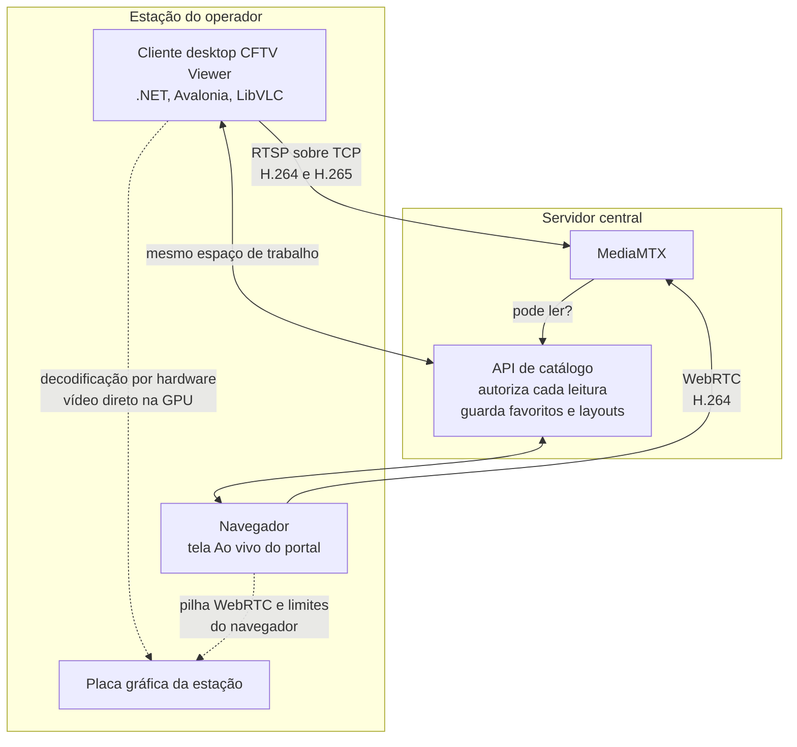

---

## 5. Catálogo como fonte de verdade

**Tempo:** 2 min.
**Mensagem-chave:** todo dado de câmera nasce e muda na API, com revisão e autor; clientes, servidores de vídeo e mapas
derivam dela.

**Fala sugerida**

- As planilhas das concessionárias são importadas como entrada não confiável: cada linha é validada e relatada, nenhuma
  derruba a importação; links incompletos são completados por um dicionário de fabricantes e modelos.
- Cada alteração gera uma revisão; exclusões são lógicas. Os clientes sincronizam só o que mudou desde a última vez.
- A configuração do MediaMTX, central e de cada borda, é gerada só pela API: a credencial de uma câmera vai apenas para
  o nó que a puxa.
- O caminho de cada câmera no servidor de vídeo é estável: layouts salvos e links continuam válidos.

<!-- diagrama: catalogo -->
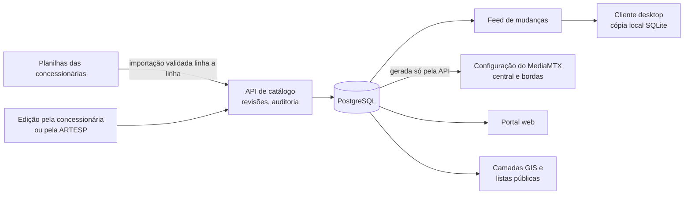

---

## 6. A concessionária no sistema

**Tempo:** 4 min.
**Mensagem-chave:** a concessionária mantém o próprio cadastro atualizado dentro do CFTV, com escopo restrito, sem senha e
sem acesso a vídeo; tudo o que faz fica registrado.

**Fala sugerida**

- Entrada: e-mail e código de seis dígitos, válido por dez minutos; não há senha para vazar. A resposta é a mesma para
  e-mail conhecido ou desconhecido.
- Credenciamento: formulário público (nome, e-mail, telefone, concessionárias, justificativa) vai à fila do grupo de
  credenciamento da ARTESP, que aprova confirmando as concessionárias vinculadas ou recusa com motivo.
- O que vê: só as câmeras das concessionárias a que está vinculada, na lista e no mapa, com as pendências do cadastro.
- O que faz: cadastra câmera nova, corrige identificação, localização e equipamento, edita a URL, o usuário e a senha do
  fluxo de vídeo, desativa com motivo obrigatório e reativa.
- O que não faz: não assiste vídeo, não tem chaves, não vê auditoria geral; não altera o identificador na concessionária
  nem o caminho no servidor de vídeo.
- Garantias: a senha nunca é exibida de volta; nada é excluído, só desativado; o histórico mostra quem alterou o quê.
- Câmera desativada sai do servidor de vídeo e das bordas na próxima sincronização e deixa de ser testada.

<!-- diagrama: concessionaria -->
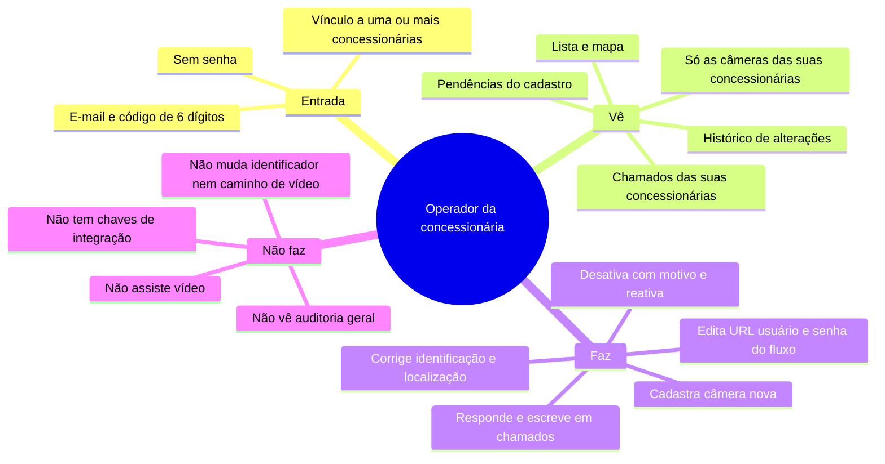

<!-- diagrama: credenciamento -->
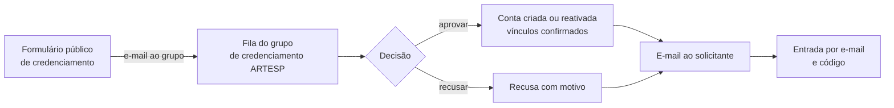

---

## 7. Chamados e avisos por e-mail

**Tempo:** 3 min.
**Mensagem-chave:** problemas com câmeras deixam de ser threads de e-mail e passam a ser chamados com prazo, conversa
imutável e avisos automáticos com regras por concessionária.

**Fala sugerida**

- A ARTESP abre o chamado para uma concessionária: título, categoria (cadastro, vídeo, credenciais, outro), descrição,
  câmeras envolvidas, prazo e programação de avisos.
- A concessionária responde; ambos trocam mensagens enquanto o chamado não estiver encerrado. A ARTESP reabre quando a
  resposta não resolve e encerra em definitivo quando resolve.
- A conversa é somente acréscimo, garantido pelo banco de dados: nada se edita nem se apaga; é trilha de auditoria.
- Avisos: abertura (imediata ou agrupada em dez minutos), mensagens, reabertura, encerramento, lembretes (a cada N
  horas ou diários, até a concessionária responder) e prazo. Regras por concessionária e evento; cada chamado pode
  ajustar as suas.
- Destinatários: os cadastrados da concessionária mais os operadores credenciados; cópia da ARTESP; quem abriu recebe
  as respostas.
- Toda a correspondência passa por uma fila única, com novas tentativas e verificação de e-mail desistido no deploy.

<!-- diagrama: chamados -->
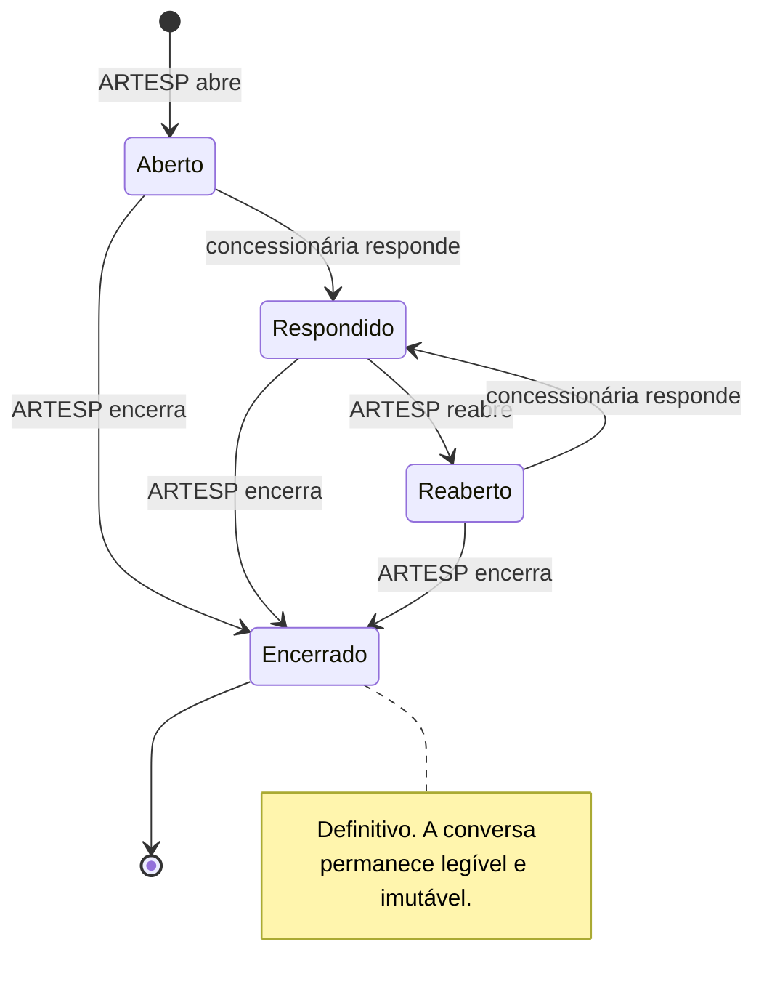

<!-- diagrama: avisos -->
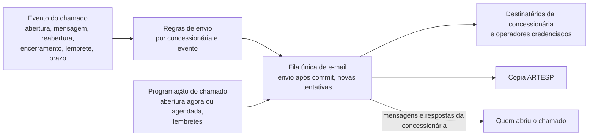

---

## 8. Publicação em mapas internos e públicos

**Tempo:** 5 min.
**Mensagem-chave:** há dois caminhos distintos para levar câmeras a mapas; o interno exige conta de rede e papel aprovado,
o público é por chave de publicação com seleção por regras e várias camadas de controle, e está desligado por padrão.

**Fala sugerida**

- Mapas internos (ArcGIS corporativo): quem tem o papel de mapas, solicitado com justificativa e aprovado por gestor,
  lê a camada GeoJSON com todas as câmeras ativas, status de saúde e link para o player do portal; um feed de mudanças
  mantém a camada sincronizada. A camada nunca inicia vídeo: o vídeo passa pelo portal, com sessão e política do
  usuário.
- Mapas públicos: uma pessoa com o papel sensível de publicação, aprovado por gestor, cria chaves de publicação. Cada
  chave carrega uma seleção por regras (todas, lote, rodovia, trecho de quilometragem, câmera individual, exclusão),
  reavaliada ao vivo: câmera nova no lote entra sozinha, câmera desativada ou bloqueada sai sozinha.
- A chave gera links prontos: camada GeoJSON para ArcGIS ou QGIS, JSON e CSV para bancos e planilhas, mapa e player
  do próprio CFTV e iframe para incorporar em outro site. As listas trazem só atributos aprovados: nunca RTSP,
  credenciais ou nós internos.
- Vídeo público: só o perfil SUB, por ticket de curta duração emitido pelo servidor; nunca MAIN.
- Controles: bloqueio "não publicável" pela GEINFRA, por câmera ou por lote, prevalece sobre toda chave e corta novos
  espectadores de imediato; teto de espectadores simultâneos por chave; validade de até um ano, renovável; rotação e
  revogação imediatas; origens permitidas; limite de chaves por pessoa; consumo atribuído ao dono da chave e visível no
  Grafana; interruptor global que desliga todas as rotas públicas, hoje desligado.
- Limites honestos: um ticket pode ser reutilizado até expirar; nada impede gravar o vídeo; cópias de camadas feitas
  por terceiros não se recolhem. A exposição do HTTPS e da porta de mídia à internet é decisão de infraestrutura ainda
  não tomada.

<!-- diagrama: publicacao -->
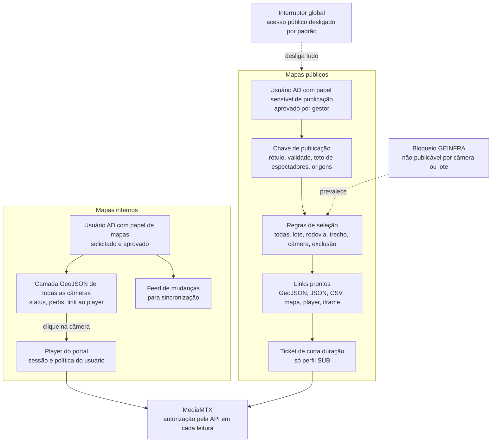

<!-- diagrama: controles -->
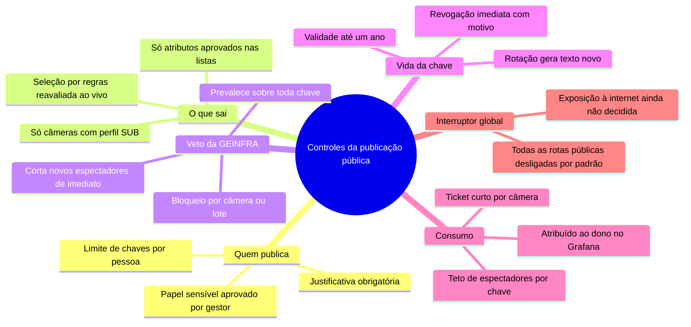

---

## 9. Bordas nas concessionárias

**Tempo:** 3 min.
**Mensagem-chave:** onde a concessionária não expõe as câmeras, um agente roda num servidor dela e a central puxa dali
por uma única porta; a borda nunca inicia conexão com a rede da ARTESP.

**Fala sugerida**

- O agente é um binário único em Go com o MediaMTX embutido, para Windows Server 2012 ou mais recente e Linux: é o
  parque real dos centros de controle das concessionárias.
- A central alcança a borda por uma só porta, usada para gestão (status, configuração, teste, logs) e para o vídeo.
  Nada abre no sentido borda para ARTESP.
- A cada 30 segundos a central coleta o estado da borda e entrega a configuração gerada pela API: só as câmeras daquele
  nó, com as credenciais daquele nó.
- A borda testa as câmeras de dentro da rede da concessionária, no mesmo caminho que o vídeo percorre, alimentando a
  saúde das câmeras.
- Instalação e atualização por script a partir de uma estação da TI, com credenciais fora do repositório.
- Por que MediaMTX 1.2.0: última versão compilada com uma toolchain que roda em Windows Server 2012; a atualização
  depende de uma decisão de arquitetura registrada.

**Em termos simples**

- Um binário único é um só arquivo executável que já contém tudo de que precisa; não há instalação de dependências no
  servidor da concessionária. Go é a linguagem que permite gerar esse arquivo para Windows e Linux.
- "Uma só porta" é como uma única porta de entrada no prédio da concessionária, aberta só para a ARTESP bater; a
  concessionária nunca precisa abrir uma porta na direção contrária.

<!-- diagrama: bordas -->
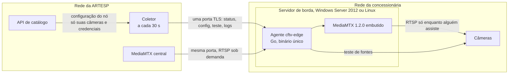

---

## 10. Segurança e controle de acesso

**Tempo:** 3 min.
**Mensagem-chave:** identidade pela rede corporativa, acessos sensíveis aprovados por um segundo gestor, segredos que
nunca saem do servidor e toda ação auditada.

**Fala sugerida**

- Usuários ARTESP: Active Directory via LDAPS com conta de serviço; perfil padrão de papéis no primeiro login;
  papéis adicionais solicitados com justificativa e aprovados por gestor diferente do solicitante.
- Concessionárias: código por e-mail, com limites de tentativas e de reenvio.
- Chaves de integração: pedidas com finalidade, aprovadas por outro gestor, exibidas ao titular sempre que necessário e substituíveis sem nova aprovação, validade limitada.
- Chaves de publicação: papel sensível, bloqueio da GEINFRA, rotação e revogação (seção 8).
- Vídeo: cada leitura autorizada pela API; políticas de consumo por papel definem perfis permitidos e limites de
  leitores; refusas registradas com motivo.
- Segredos: credenciais das câmeras cifradas no banco; arquivos de configuração com permissão restrita; logs com
  credenciais mascaradas na origem; segredos de implantação em Ansible Vault.
- Auditoria: vocabulário fechado de ações; quem, quando, o quê e valores antes e depois; exportável.

<!-- diagrama: seguranca -->
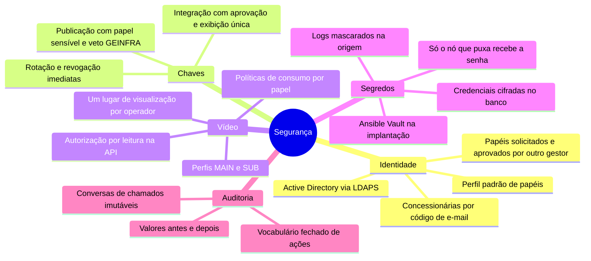

---

## 11. Operação e observabilidade

**Tempo:** 3 min.
**Mensagem-chave:** implantação reprodutível, backup diário e três visões de saúde: das câmeras, dos fluxos de vídeo e
da própria plataforma, todas no Grafana atrás do portal.

**Fala sugerida**

- Release é um commit do repositório guarda-chuva; o pacote é montado na estação de controle e a VM não acessa GitHub
  nem repositórios de pacotes, só as imagens fixadas.
- Cada implantação faz backup, migra o banco, regenera a configuração do MediaMTX, sobe tudo com verificações de saúde
  e ativa por link atômico; as últimas cinco releases ficam disponíveis para retorno.
- Saúde das câmeras: teste contínuo de todas as fontes (sem puxar vídeo), feito por quem puxa o fluxo: a borda para
  suas câmeras, a central para as diretas. Estados: ok, falhando, senha recusada, desconhecido; histórico por câmera.
- Métricas de streaming: amostragem do MediaMTX a cada 15 segundos, leitores ligados a usuários, consumo por pessoa e
  por chave.
- Plataforma: CPU, memória, disco, rede e por contêiner no Prometheus; logs dos serviços e das bordas no Loki, 30 dias.
- Grafana usa a sessão do portal: gestores administram, papel de observabilidade só lê; acesso ao banco restrito às
  tabelas de métricas.
- Trabalho em segundo plano em Celery com registro da última execução de cada job.

**Em termos simples**

- Prometheus guarda números ao longo do tempo (uso de processador, memória, quantos operadores assistem); Loki guarda
  as linhas de registro que os serviços escrevem; Grafana desenha os dois em painéis que a gestão consulta pelo portal.
- Teste contínuo de saúde: o sistema "bate na porta" de cada câmera de tempos em tempos, sem puxar vídeo, para saber se
  ela responde e se a senha ainda vale.

<!-- diagrama: operacao -->
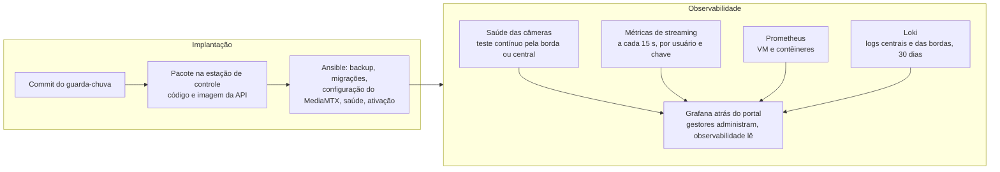

---

## 12. Estado atual e próximos passos

**Tempo:** 3 min.
**Mensagem-chave:** o sistema está completo em homologação na versão 1.0.0-beta; a produção depende de pré-requisitos de
infraestrutura e de decisões da gestão.

**Fala sugerida**

Em homologação:

| Capacidade | Situação |
|---|---|
| Catálogo web: consulta, mapa, exportação, auditoria, ao vivo em WebRTC | homologação |
| Cliente desktop Windows e Linux, mosaico, layouts, download pelo portal | homologação |
| Concessionárias: credenciamento, cadastro mantido por elas, chamados, avisos por e-mail | homologação |
| Chaves de integração com aprovação; papéis e políticas de consumo; perfis MAIN e SUB | homologação |
| Camada GIS interna; chaves de publicação para mapas públicos | homologação, acesso público desligado |
| Saúde das câmeras com histórico; métricas; logs centralizados; Grafana pelo portal | homologação |
| Agente de borda com instalador; teste de campo com vídeo de ponta a ponta | homologação |
| Ambiente de desenvolvimento local completo em um comando | disponível |

Pré-requisitos para produção, por responsável:

- Infraestrutura: VM de produção conforme dimensionamento; conta de serviço dedicada no Active Directory; liberação do
  relay de e-mail; alcance do mapa base (tiles) pelas estações.
- Segurança de rede: RTSPS ou segmento confiável para os links RTSP com chave; decisão sobre exposição das rotas
  públicas à internet; regras de rede e exclusão de antivírus nos servidores de borda.
- Gestão: nomear o primeiro gestor GEINFRA; definir políticas de consumo iniciais; definir quem recebe o papel de
  publicação.
- Operação: janela de implantação, plano de retorno, rotina de backup externo.

<!-- diagrama: trajetoria -->
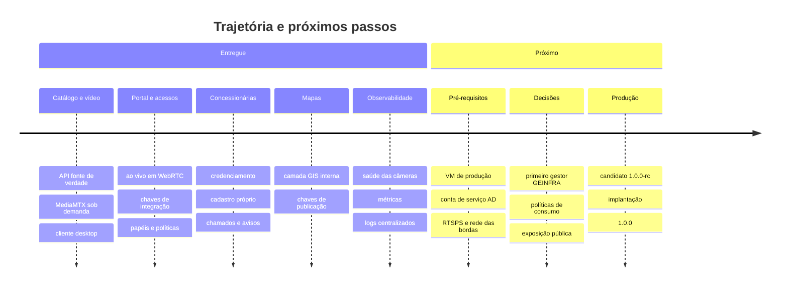

---

## 13. Perguntas

Tempo restante. Perguntas prováveis e respostas curtas:

- **Quantas pessoas podem assistir ao mesmo tempo?** Não há limite fixo. Cada câmera é puxada uma vez; o custo cresce
  com o número de câmeras distintas abertas, não com o de espectadores. As políticas de consumo permitem impor limites
  por papel quando a medição indicar.
- **E se a concessionária trocar a senha da câmera?** O teste contínuo marca a câmera como "senha recusada" em
  minutos; a concessionária corrige o fluxo no portal ou a ARTESP abre um chamado.
- **O vídeo é gravado?** Não. O sistema distribui ao vivo; não há armazenamento de vídeo.
- **Dá para integrar com outro sistema?** Sim, com chave de integração aprovada: catálogo, feed de mudanças e vídeo
  dentro da política do dono da chave.
- **Qual o risco das publicações públicas?** Só o perfil leve, por ticket curto, com veto da GEINFRA e interruptor
  global. O que não se controla: regravação pelo espectador e cópias de camadas feitas por terceiros.

---

## Apêndice A. Glossário

| Termo | Significado |
|---|---|
| RTSP | Protocolo de controle de fluxos de vídeo usado pelas câmeras e pelo cliente desktop |
| RTSPS | RTSP sobre TLS; pré-requisito para links com chave fora de segmento confiável |
| WebRTC, WHEP | Transporte de vídeo em tempo real para navegadores; WHEP é o protocolo de sinalização para assistir |
| MediaMTX | Servidor de vídeo de código aberto que puxa as câmeras sob demanda e redistribui aos espectadores |
| LibVLC | Motor de reprodução do VLC, usado pelo cliente desktop com decodificação por hardware |
| Perfil MAIN e SUB | Fluxo principal em alta resolução e fluxo leve da mesma câmera; mosaicos usam SUB quando existe |
| Codec | Método de compactar e descompactar vídeo para que caiba na rede; H.264 e H.265 são os dois usados pelas câmeras |
| H.264 e H.265 | H.264: o codec mais comum, reproduzido por todo navegador. H.265: mais novo, compacta cerca de duas vezes melhor, mas não é reproduzido pelo WebRTC do navegador |
| Decodificação por hardware | Descompactar o vídeo num circuito dedicado da placa gráfica, em vez do processador principal; permite muitas câmeras numa estação comum |
| GPU | Placa gráfica da estação; além de desenhar a tela, decodifica vídeo |
| Mosaico | Grade de células, cada uma com uma câmera ao vivo (1×1, 2×2, 4×2, 3×3, 4×4) |
| VMS | Sistema de gerenciamento de vídeo, o software comercial de monitoramento, como Digifort e SecurOS; alguns cobram licença por câmera |
| VM | Servidor virtual: uma máquina que existe dentro de outra, provida pela infraestrutura da ARTESP |
| Contêiner | Caixa isolada dentro da VM com um serviço e tudo de que ele precisa; o CFTV é um conjunto de contêineres |
| Ansible | Ferramenta que repete a instalação do servidor sempre do mesmo jeito, a partir de um roteiro escrito |
| Binário único | Um só arquivo executável que contém tudo de que precisa; é como o agente de borda é distribuído |
| Prometheus, Loki, Grafana | Guarda de números ao longo do tempo, guarda de registros e painéis que mostram os dois |
| Borda | Servidor da concessionária onde roda o agente com MediaMTX embutido; a central puxa dali |
| Catálogo | Cadastro das câmeras na API; fonte de verdade de todo o sistema |
| Revisão | Número que cresce a cada alteração de câmera; permite sincronizar só o que mudou |
| Feed de mudanças | Lista paginada de revisões e exclusões para clientes e camadas GIS |
| LDAPS | Consulta ao Active Directory sobre TLS para autenticar usuários ARTESP |
| Papel | Permissão nomeada; alguns são solicitáveis com justificativa, outros sensíveis e só concedidos por gestor |
| Política de consumo | Conjunto de perfis permitidos e limites de leitores associado a papéis |
| Chave de integração | Credencial de longa duração de uma pessoa para sistemas externos; aprovada por outro gestor |
| Chave de publicação | Credencial pública que abre só a seleção de câmeras de um mapa, em SUB |
| Ticket | Credencial de segundos de duração emitida pelo servidor para um espectador público |
| GeoJSON | Formato padrão de camadas geográficas; lido pelo ArcGIS e pelo QGIS |
| ETag | Marca de versão de uma resposta; o consumidor baixa de novo só quando mudou |
| Ansible Vault | Arquivo cifrado com os segredos de implantação de cada ambiente |
| ADR | Registro de decisão de arquitetura; cada escolha relevante tem o seu nos repositórios |
| Toolchain | Conjunto de compilador e ferramentas que gera um programa; define em quais sistemas ele roda |

## Apêndice B. Termos técnicos explicados para quem não é da área
Explicações em linguagem comum, agrupadas por tema, para acompanhar a apresentação sem formação técnica. O
Apêndice A traz as definições curtas de referência.

### Vídeo e câmeras

**Câmera IP e fluxo de vídeo.** A câmera de rodovia é um pequeno computador ligado à rede que transmite vídeo continuamente. Esse vídeo em trânsito é o fluxo (stream); quem quiser assistir pede o fluxo à câmera, como se sintonizasse um canal.

**RTSP.** O idioma que câmeras e servidores de vídeo usam para pedir e entregar um fluxo ao vivo. É o padrão da indústria de câmeras; o cliente desktop fala RTSP com o servidor.

**WebRTC.** A tecnologia de vídeo em tempo real que já vem dentro dos navegadores, a mesma das chamadas de vídeo. Permite assistir sem instalar nada; é o que a tela "Ao vivo" usa.

**Codec.** O método de compactar o vídeo para que caiba na rede e descompactá-lo para exibir, como um arquivo zip para imagens em movimento. Sem compactação, uma só câmera encheria a rede.

**H.264 e H.265.** Os dois codecs usados pelas câmeras. H.264 é o mais comum e todo navegador o reproduz. H.265 é mais novo e compacta cerca de duas vezes melhor, mas os navegadores não o reproduzem pelo WebRTC; algumas câmeras só oferecem esse formato, e por isso só são assistíveis no cliente desktop.

**Decodificação por hardware.** Descompactar o vídeo num circuito dedicado da placa gráfica, em vez de usar o processador principal. É como ter um funcionário especializado só para isso: a estação exibe 16 câmeras com folga em vez de travar.

**GPU.** A placa gráfica da estação. Além de desenhar a tela, descompacta vídeo; "vídeo direto na GPU" significa que a imagem vai para a tela sem passar de novo pela memória do programa.

**Perfis MAIN e SUB.** A mesma câmera pode oferecer duas versões do vídeo: a completa, em alta resolução (MAIN), e uma leve (SUB). No mosaico de muitas câmeras usa-se a leve; ao ampliar uma câmera, a completa.

**Mosaico.** A grade de células da tela do operador, cada uma com uma câmera ao vivo: 2×2, 4×2, 4×4. Cada célula é um fluxo que chega à estação.

**Latência.** O atraso entre o que acontece na rodovia e o que aparece na tela. Abaixo de meio segundo é praticamente tempo real.

**Transcodificação.** Converter o vídeo de um formato para outro no servidor. Custa um processo por câmera; para 4.600 câmeras seria inviável, por isso o CFTV não transcodifica: repassa o vídeo como vem da câmera.

**VMS.** Sistema de gerenciamento de vídeo: o software comercial de monitoramento, como Digifort e SecurOS. Alguns cobram licença por câmera; o CFTV substitui essa função sem licença.

**MediaMTX.** O servidor de vídeo do CFTV, de código aberto. Recebe o fluxo da câmera uma única vez e o repassa a quem tiver autorização, como uma central telefônica que liga vários ramais a uma mesma linha.

### Rede e acesso

**Porta.** Uma "porta de entrada" numérica num servidor; cada serviço atende numa porta. Abrir uma porta no firewall é permitir que alguém de fora bata nela. O agente de borda usa uma só, e só a ARTESP bate.

**Firewall.** O porteiro da rede: decide quais conexões entram e saem. Cada regra nova é uma exceção que a equipe de rede precisa manter.

**Borda (edge).** Um servidor da concessionária, dentro da rede dela, onde roda o agente do CFTV. Serve de ponte: a central puxa o vídeo da borda, e a borda puxa das câmeras que a ARTESP não alcança diretamente.

**Active Directory e LDAPS.** O cadastro corporativo de usuários e senhas da ARTESP (Active Directory) e o canal protegido pelo qual o CFTV consulta esse cadastro (LDAPS). O operador entra com a mesma senha da rede.

**Sessão e token.** Depois do login, o sistema entrega ao programa do operador um crachá temporário (token) que vale por algumas horas; cada pedido seguinte mostra o crachá em vez da senha.

**Código por e-mail.** A forma de entrada das concessionárias: em vez de senha, um código de seis dígitos enviado ao e-mail, válido por dez minutos. Nenhuma senha para vazar.

**Chave de integração.** Um crachá de longa duração para que outro sistema (não uma pessoa) leia o catálogo e o vídeo. É pedida com justificativa, aprovada por outro gestor, exibida ao titular sempre que necessário e substituível sem nova aprovação.

**Chave de publicação.** Um crachá público que abre só a seleção de câmeras de um mapa, sempre na versão leve do vídeo. Pode ser trocada ou cancelada a qualquer momento pelo dono ou pela GEINFRA.

**Ticket.** Um crachá de poucos segundos de validade que o servidor emite para cada espectador público; expira sozinho.

**HTTPS e TLS.** O cadeado do navegador: o conteúdo viaja cifrado entre a estação e o servidor. TLS é o mecanismo por trás do cadeado; RTSPS é o RTSP com esse mesmo cadeado.

**Relay de e-mail.** O servidor da ARTESP que entrega os e-mails que o CFTV envia (códigos de acesso, avisos de chamados).

### Servidor, dados e operação

**VM.** Um servidor virtual: uma máquina que existe dentro de outra, provida pela infraestrutura da ARTESP. Para quem usa, comporta-se como um servidor comum.

**Contêiner e Docker.** Caixas isoladas dentro da VM, uma para cada serviço (banco, API, vídeo, painéis), com tudo de que cada um precisa. Docker é a ferramenta que monta e executa essas caixas.

**Ansible e release imutável.** Ansible repete a instalação do servidor sempre do mesmo jeito, a partir de um roteiro escrito. Uma release imutável é uma versão que, uma vez montada, não muda: se algo falhar, volta-se à anterior em minutos.

**API.** A "porta de serviço" por onde programas conversam com o sistema: o cliente desktop, o portal, os mapas e os integradores pedem dados à API de catálogo em vez de acessar o banco diretamente.

**Contrato OpenAPI.** A descrição formal de tudo o que a API aceita e devolve. Cliente e portal são gerados a partir dela, então nunca divergem do servidor.

**Banco de dados e PostgreSQL.** Onde o catálogo, os usuários, a auditoria e as métricas ficam guardados. PostgreSQL é o banco de código aberto usado.

**Revisão e feed de mudanças.** Cada alteração de câmera recebe um número crescente (revisão). Quem sincroniza pede "o que mudou desde a revisão N" e recebe só a diferença, em vez de baixar tudo.

**GeoJSON.** O formato padrão de camadas de mapa; o ArcGIS e o QGIS leem direto. O CFTV entrega as câmeras nesse formato para os mapas.

**Prometheus, Loki e Grafana.** Prometheus guarda números ao longo do tempo (uso de processador, quantos assistem); Loki guarda os registros que os serviços escrevem; Grafana desenha os dois em painéis que a gestão consulta pelo portal.

**Teste de saúde.** O sistema "bate na porta" de cada câmera de tempos em tempos, sem puxar vídeo, para saber se ela responde e se a senha ainda vale.

**Binário único e toolchain.** Um só arquivo executável que contém tudo de que precisa, sem instalação no servidor da concessionária. Toolchain é o conjunto de compilador e ferramentas que gera esse arquivo e define em quais sistemas ele roda.

**Código aberto.** Software cujo código-fonte é público e pode ser usado sem licença paga. Tudo o que o CFTV usa é de código aberto, e o CFTV em si é software próprio da ARTESP.

**ADR.** Registro de decisão de arquitetura: um documento curto que diz o que foi decidido, por quê e o que foi descartado. Cada escolha relevante do CFTV tem o seu.

## Apêndice C. Fontes

- `README.md` do repositório guarda-chuva e `deploy/README.md`.
- Memória do projeto em `.agents/memory/` (arquitetura, funcionalidades, bordas).
- Especificações em `docs/superpowers/specs/`: catálogo, ao vivo no navegador, bordas, concessionárias e chamados,
  chaves de publicação, saúde das câmeras, logs centralizados.
- Decisões de arquitetura da API (`api/docs/decisions/`), em especial 0002, 0004, 0005, 0007, 0008 a 0015 e 0017.
- Decisões de arquitetura do cliente desktop (`client/docs/decisions/`): 0001 (stack), 0003 (caminho de vídeo nativo e
  medições), 0005 (telemetria), 0006 (um lugar por vez) e 0007 (perfil por célula).
- Fluxos de comunicação com as bordas em `edge/docs/FLUXOS.md`.
