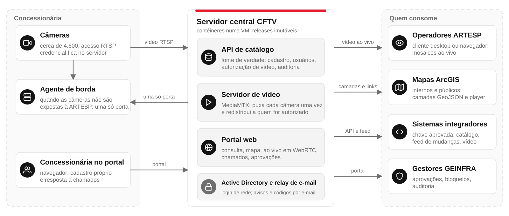
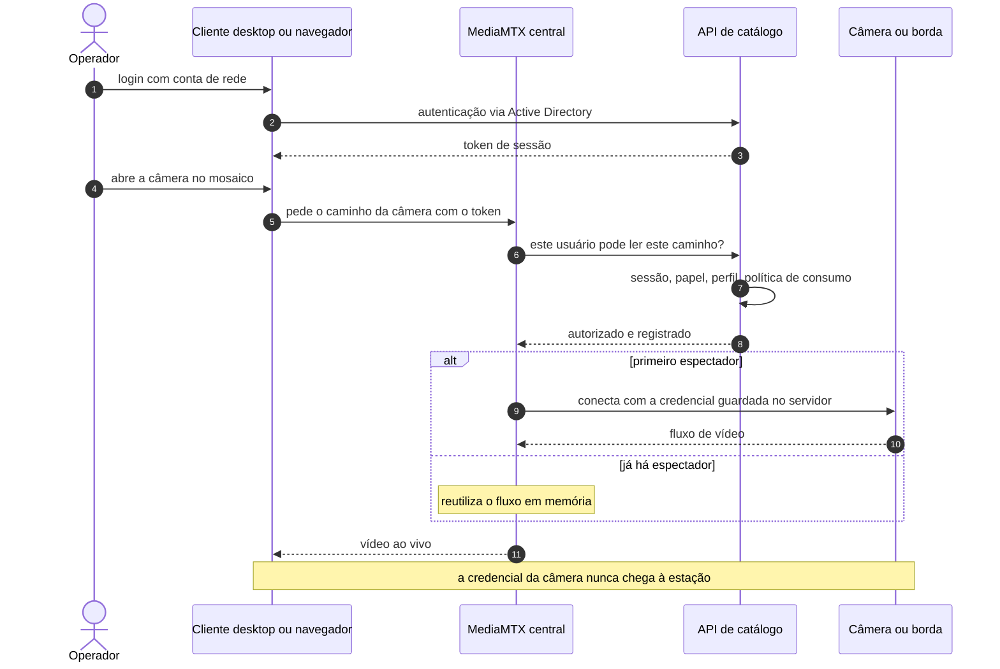
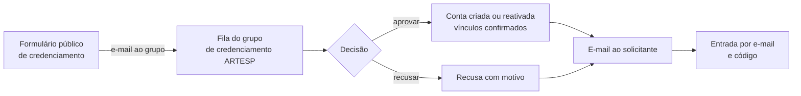
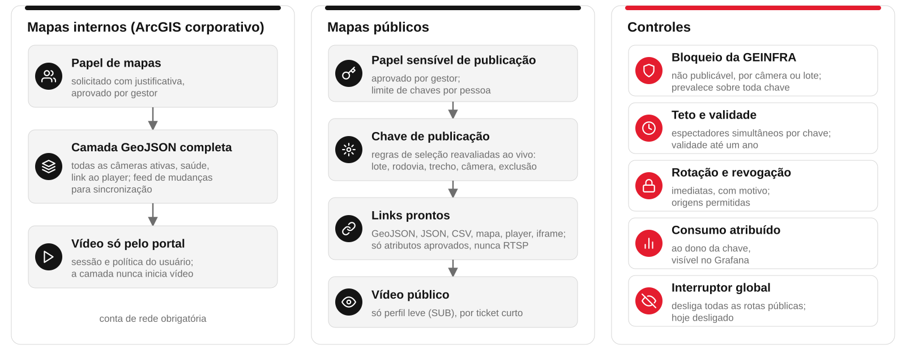

# CFTV ARTESP: roteiro resumido para a gestão de TI

Roteiro de 15 minutos, em doze slides, para apresentar o sistema CFTV a gestores de TI numa reunião curta. Cobre o
problema, o que o sistema faz, a arquitetura em alto nível, os perfis de acesso, a concessionária, a publicação em mapas,
a justificativa do cliente desktop, as tecnologias e o estado atual. A versão completa, de 35 a 40 minutos, com
diagramas detalhados, apêndices e glossário, está em [`APRESENTACAO.md`](APRESENTACAO.md); os slides correspondentes
estão em `site/index.html` (completa) e `site/resumo.html` (esta versão).

Regras do roteiro: nenhum endereço de rede interno, nome de servidor de borda ou credencial; os números são os públicos
do projeto. Os dois diagramas Mermaid (fluxo de vídeo e credenciamento) são os mesmos da versão completa; os diagramas
de arquitetura e de publicação são SVG próprios em `site/img/arq-*.svg`.

## Agenda

| # | Slide | Minutos | Acumulado |
|---|---|---|---|
| 1 | Capa | 0,5 | 0,5 |
| 2 | Contexto e problema | 1,5 | 2 |
| 3 | O CFTV em uma frase e seis capacidades | 1 | 3 |
| 4 | Arquitetura de alto nível | 2 | 5 |
| 5 | Fluxo de vídeo | 1,5 | 6,5 |
| 6 | Perfis e permissões | 1,5 | 8 |
| 7 | A concessionária no sistema | 1,5 | 9,5 |
| 8 | Publicação em mapas internos e públicos | 2 | 11,5 |
| 9 | Cliente desktop: justificativa técnica | 1,5 | 13 |
| 10 | Tecnologias e custo | 1 | 14 |
| 11 | Estado atual e próximos passos | 1 | 15 |
| 12 | Encerramento e perguntas | restante | 15 |

---

## 1. Capa

Nome do sistema, público e data. Uma frase: plataforma de catálogo, vídeo ao vivo e relacionamento auditado com as
concessionárias para cerca de 4.600 câmeras das rodovias concedidas.

---

## 2. Contexto e problema

**Tempo:** 1,5 min.
**Mensagem-chave:** a ARTESP fiscaliza cerca de 4.600 câmeras das concessionárias, mas o inventário era só cadastro, o
acesso ao vídeo não tinha controle, conviviam vários clientes de vídeo, um deles licenciado por câmera, e o
relacionamento com as concessionárias corria por e-mail.

**Fala sugerida**

- Inventário: o sistema MITS mantém um catálogo das câmeras, mas limitado ao cadastro; não há disponibilidade, vídeo,
  histórico de alterações nem interface para outros sistemas. As planilhas das concessionárias, cada uma no seu
  formato, traziam as credenciais das câmeras em texto puro.
- Acesso: assistir a uma câmera exigia conhecer o endereço e a senha dela; cada operador abria a própria conexão com
  a concessionária, sem registro de quem via o quê, e ninguém sabia quais câmeras respondiam antes de tentar.
- Ferramentas: conviviam vários clientes de vídeo (VMS), como Digifort e SecurOS, cada um com sua tela, seu cadastro e
  seu treinamento. O SecurOS da ARTESP cobra uma licença por câmera: licenciar as cerca de 4.600 era inviável e o custo
  crescia a cada câmera nova.
- Relacionamento: alterações de cadastro e problemas com câmeras eram tratados por e-mail, sem prazo nem auditoria.

---

## 3. O CFTV em uma frase e seis capacidades

**Tempo:** 1 min.
**Mensagem-chave:** o CFTV é software próprio da ARTESP, de código aberto, que reúne catálogo, vídeo ao vivo e
relacionamento com as concessionárias num só lugar, sem licença por câmera, por estação ou por operador.

**Fala sugerida**

1. Catálogo único: toda câmera nasce e muda na API, com revisão, autor e auditoria; planilhas entram como importação
   validada.
2. Vídeo ao vivo sob demanda: o servidor puxa cada câmera uma única vez e redistribui a quantos assistirem; a
   credencial da câmera nunca chega à estação.
3. Concessionária dentro do sistema: mantém o próprio cadastro, responde a chamados com prazo e trilha imutável; não
   assiste vídeo.
4. Publicação em mapas: camada para o ArcGIS corporativo e chaves de publicação para mapas públicos, com veto da
   GEINFRA e interruptor global.
5. Segurança: login de rede, acessos sensíveis aprovados por um segundo gestor, segredos só no servidor, toda ação
   auditada; cada chave de acesso tem limites próprios de vídeos simultâneos, banda, origem e horário, com padrões
   definidos pela GEINFRA; o consumo de cada chave (agora e histórico) é acompanhado no portal, com relatórios para
   prestação de contas.
6. Operação observável: saúde de cada câmera com histórico, métricas, logs centralizados e painéis no Grafana.

---

## 4. Arquitetura de alto nível

**Tempo:** 2 min.
**Mensagem-chave:** um servidor central concentra catálogo, vídeo e portal; as câmeras chegam direto ou por um agente
de borda instalado na concessionária; operadores, mapas, integradores e gestores consomem o central, cada um pelo seu
caminho.

**Fala sugerida**

- Esquerda, a concessionária: as câmeras (acesso RTSP) e, quando ela não expõe as câmeras à ARTESP, um agente de
  borda num servidor dela, alcançado pela central por uma só porta. Nada abre no sentido borda para ARTESP.
- Centro, o servidor central do CFTV, em contêineres numa VM: a API de catálogo (fonte de verdade: cadastro, usuários,
  autorização de vídeo, auditoria), o servidor de vídeo MediaMTX (puxa cada câmera uma vez e redistribui) e o portal
  web (consulta, mapa, ao vivo, chamados). Apoiam-no o Active Directory, para o login, e o relay de e-mail, para os
  avisos.
- Direita, quem consome: operadores da ARTESP pelo cliente desktop ou pelo navegador; mapas ArcGIS internos e
  públicos por camadas GeoJSON; sistemas integradores pela API, com chave aprovada; gestores GEINFRA pelas telas de
  aprovação, bloqueio e auditoria. O operador da concessionária entra pelo portal só para cadastro e chamados.

---

## 5. Fluxo de vídeo

**Tempo:** 1,5 min.
**Mensagem-chave:** cada leitura de vídeo é autorizada pela API e registrada; a câmera é puxada uma vez e compartilhada;
a credencial da câmera vive só no servidor.

<!-- diagrama: video -->

**Fala sugerida**

- O operador entra com a conta de rede e recebe um token de sessão válido para catálogo e vídeo.
- O cliente pede a câmera ao MediaMTX; o MediaMTX pergunta à API se aquele usuário pode ler aquele caminho; a API
  verifica sessão, papel, perfil permitido e política de consumo, e registra.
- Só então o servidor conecta à câmera, direto ou pela borda, com a credencial que fica no servidor. O segundo
  espectador recebe a cópia em memória; quando o último fecha, a conexão com a câmera termina.
- No navegador o transporte é WebRTC; no cliente desktop, RTSP. Um operador assiste em um lugar por vez.

**Em termos simples:** RTSP é o idioma das câmeras e servidores de vídeo; WebRTC é o vídeo em tempo real que o
navegador já traz; MediaMTX é a central que recebe o fluxo da câmera uma vez e o repassa a quem tiver autorização.

---

## 6. Perfis e permissões

**Tempo:** 1,5 min.
**Mensagem-chave:** cada perfil vê e faz só o que lhe cabe; papéis adicionais e acessos sensíveis exigem justificativa e
aprovação de um gestor diferente do solicitante.

| Perfil | Entra com | Vê e faz | Não faz |
|---|---|---|---|
| Operador ARTESP | conta de rede (Active Directory) | assiste em mosaico no cliente desktop ou no navegador; favoritos e layouts | não altera cadastro nem aprova acessos |
| Analista de mapas | conta de rede e papel de mapas aprovado | camada GeoJSON no ArcGIS corporativo; com papel sensível, chaves de publicação para mapas públicos | não vê credenciais nem inicia vídeo pela camada |
| Gestor GEINFRA | conta de rede e papel de gestão | aprova papéis, chaves e credenciamentos; bloqueia câmeras para publicação; consulta auditoria | não aprova o próprio pedido |
| Operador da concessionária | e-mail e código de seis dígitos, sem senha | só as câmeras da sua concessionária: cadastra, corrige, desativa com motivo; responde a chamados | não assiste vídeo, não tem chaves, não vê auditoria geral |
| Sistema integrador | chave de integração aprovada, atribuída a uma pessoa | lê o catálogo, o feed de mudanças e o vídeo dentro da política do dono da chave | não escreve no catálogo |

**Fala sugerida**

- Chave de integração: pedida com rótulo, finalidade e validade (30 a 730 dias); aprovada por um gestor que não seja o
  dono; exibida ao titular sempre que necessário, com registro; substituível sem nova aprovação; guardada cifrada; registra o último uso; revogável.
- Chave externa: a GEINFRA entrega a uma pessoa ou organização sem conta de rede uma credencial RTSP de alcance
  delimitado: câmeras definidas por regras (lote, rodovia, trecho ou câmera), perfil de vídeo (somente SUB ou MAIN e
  SUB) e validade de até 365 dias. Atribuída a um gestor responsável; qualquer gestor pode exibir, exportar com os
  links prontos, prorrogar, renovar e revogar; toda operação é auditada. O destinatário recebe por e-mail os avisos
  de criação, renovação, revogação e vencimento.
- Feed de mudanças: o integrador pergunta "o que mudou desde a revisão N" e recebe só a diferença, em ordem de revisão,
  em vez de baixar o catálogo inteiro.

---

## 7. A concessionária no sistema

**Tempo:** 1,5 min.
**Mensagem-chave:** a concessionária entra sem senha, mantém o próprio cadastro com escopo restrito e responde a chamados
com prazo; tudo fica registrado e nada é excluído.

<!-- diagrama: credenciamento -->

**Fala sugerida**

- Credenciamento: formulário público vai à fila do grupo de credenciamento da ARTESP, que aprova confirmando as
  concessionárias vinculadas ou recusa com motivo. Entrada por e-mail e código de seis dígitos, válido por dez minutos.
- Cadastro: cadastra câmera nova, corrige identificação, localização e equipamento, edita o fluxo de vídeo, desativa
  com motivo obrigatório e reativa. A senha da câmera nunca é exibida de volta; nada é excluído, só desativado.
- Chamados: a ARTESP abre com título, categoria, câmeras, prazo e programação de avisos; a concessionária responde;
  a conversa é somente acréscimo, garantida pelo banco. Avisos por e-mail na abertura, nas mensagens, nos lembretes e
  no prazo, com regras por concessionária.

---

## 8. Publicação em mapas internos e públicos

**Tempo:** 2 min.
**Mensagem-chave:** dois caminhos distintos: o interno exige conta de rede e papel aprovado; o público usa chave de
publicação com seleção por regras e várias camadas de controle, e está desligado por padrão.

**Fala sugerida**

- Mapas internos (ArcGIS corporativo): papel de mapas solicitado com justificativa e aprovado por gestor; camada GeoJSON
  com todas as câmeras ativas, saúde e link ao player do portal; feed de mudanças para sincronização. A camada nunca
  inicia vídeo: o vídeo passa pelo portal, com a sessão e a política do usuário.
- Mapas públicos: papel sensível de publicação, aprovado por gestor, cria chaves de publicação. Cada chave carrega
  regras de seleção (todas, lote, rodovia, trecho, câmera, exclusão) reavaliadas ao vivo e gera links prontos: GeoJSON
  para ArcGIS ou QGIS, JSON e CSV, mapa e player do CFTV, iframe. As listas trazem só atributos aprovados, nunca RTSP,
  credenciais ou nós internos. Vídeo público só no perfil leve (SUB), por ticket de curta duração.
- Controles: bloqueio "não publicável" da GEINFRA, por câmera ou lote, prevalece sobre toda chave e corta novos
  espectadores de imediato; teto de espectadores por chave; validade de até um ano, rotação e revogação imediatas;
  origens permitidas; limite de chaves por pessoa; consumo atribuído ao dono e visível no Grafana; interruptor global,
  hoje desligado.
- Limites: um ticket pode ser reutilizado até expirar; nada impede gravar o vídeo; cópias de camadas feitas por
  terceiros não se recolhem. A exposição à internet é decisão de infraestrutura ainda não tomada.

---

## 9. Cliente desktop: justificativa técnica

**Tempo:** 1,5 min.
**Mensagem-chave:** o portal oferece o "Ao vivo" para consulta sem instalação; a estação de operação, que mantém mosaicos
de muitas câmeras por horas, precisa do cliente desktop, que decodifica por hardware e reproduz H.265.

| Aspecto | "Ao vivo" no navegador | Cliente desktop |
|---|---|---|
| Instalação | nenhuma | instalador para Windows e Linux, baixado do portal |
| Decodificação | por software, no processador | por hardware, na placa gráfica: 8 câmeras 1080p ocupam 24% a 32% de um núcleo, contra 181% por software |
| Codecs | H.264 (WebRTC) | H.264 e H.265: câmeras H.265 só são assistíveis aqui |
| Mosaico | até 16 células (configurável) | limite definido pela TI; tela cheia e multimonitor sem moldura; atalhos; arrastar e soltar |
| Catálogo | consulta à API | cópia local: busca e filtros instantâneos |
| Sessão longa | navegador reduz prioridade de abas em segundo plano | estável por horas; reconexão automática; telemetria por célula |
| Servidor e autorização | os mesmos | os mesmos: favoritos e layouts compartilhados |
| Licença | nenhuma | nenhuma: substitui os VMS comerciais licenciados por câmera ou estação |

**Em termos simples:** codec é o método de compactar o vídeo; H.264 é o mais comum e todo navegador o reproduz; H.265
compacta cerca de duas vezes melhor, mas o navegador não o reproduz, e algumas câmeras das concessionárias só oferecem
esse formato. Decodificar por hardware é usar um circuito dedicado da placa gráfica em vez do processador principal.

**Limite honesto:** a medição de referência foi feita em estação de desenvolvimento Linux; a medição do navegador em
estação de sala de controle com 4, 8, 9 e 16 células é item pendente da homologação.

---

## 10. Tecnologias e custo

**Tempo:** 1 min.
**Mensagem-chave:** cada componente usa a tecnologia que resolve a sua restrição concreta; todas são de código aberto,
sem licença por câmera, por estação ou por operador, e cada escolha está registrada numa decisão de arquitetura.

| Componente | Tecnologia | Motivo |
|---|---|---|
| API de catálogo | Python, Django, PostgreSQL | painel de cadastro e importação prontos; API REST com contrato OpenAPI; revisões ordenadas no banco |
| Portal web | React, TypeScript | aplicação estática sem instalação; cliente gerado do contrato, tela e API não divergem |
| Cliente desktop | C#, .NET, Avalonia, LibVLC | um código para Windows e Linux; decodificação por hardware; H.264 e H.265 |
| Agente de borda | Go, binário único | único toolchain que gera um só executável para Windows Server 2012 e Linux, o parque real das concessionárias |
| Servidor de vídeo | MediaMTX | RTSP e WebRTC prontos; autorização por leitura; sem transcodificação |
| Implantação e operação | Docker, Ansible, Caddy, Prometheus, Loki, Grafana | padrão do escritório de projetos da ARTESP; releases imutáveis; retorno em minutos |

---

## 11. Estado atual e próximos passos

**Tempo:** 1 min.
**Mensagem-chave:** o sistema está completo em homologação na versão 1.0.0-beta; a produção depende de pré-requisitos de
infraestrutura e de decisões da gestão.

**Em homologação**

- Catálogo web com consulta, mapa, exportação, auditoria e ao vivo em WebRTC.
- Cliente desktop Windows e Linux, com mosaico e layouts, baixado pelo portal.
- Concessionárias: credenciamento, cadastro mantido por elas, chamados e avisos por e-mail.
- Chaves de integração aprovadas; papéis e políticas de consumo; perfis MAIN e SUB.
- Camada GIS interna e chaves de publicação para mapas públicos, com acesso público desligado.
- Saúde das câmeras com histórico, métricas, logs centralizados e Grafana pelo portal.
- Agente de borda com instalador e teste de campo com vídeo de ponta a ponta.

**Pré-requisitos para produção**

- Infraestrutura: VM de produção dimensionada; conta de serviço dedicada no Active Directory; liberação do relay de
  e-mail; alcance do mapa base pelas estações.
- Segurança de rede: RTSPS ou segmento confiável para os links RTSP com chave; decisão sobre exposição pública; regras
  de rede e exclusão de antivírus nos servidores de borda.
- Gestão: nomear o primeiro gestor GEINFRA; definir políticas de consumo iniciais; definir quem recebe o papel de
  publicação.
- Operação: janela de implantação, plano de retorno, rotina de backup externo.

---

## 12. Encerramento e perguntas

Tempo restante. Respostas curtas às perguntas prováveis:

- **Quantas pessoas podem assistir ao mesmo tempo?** Não há limite fixo; cada câmera é puxada uma vez, e o custo cresce
  com o número de câmeras distintas abertas, não com o de espectadores.
- **E se a concessionária trocar a senha da câmera?** O teste contínuo marca a câmera como "senha recusada" em
  minutos; a concessionária corrige no portal ou a ARTESP abre um chamado.
- **Dá para integrar com outro sistema?** Sim, com chave de integração aprovada: catálogo, feed de mudanças e vídeo
  dentro da política do dono da chave.
- **Qual o risco das publicações públicas?** Só o perfil leve, por ticket curto, com veto da GEINFRA e interruptor
  global; o que não se controla é a regravação pelo espectador e cópias de camadas feitas por terceiros.

Versão completa, com glossário e termos técnicos explicados: [`APRESENTACAO.md`](APRESENTACAO.md).
